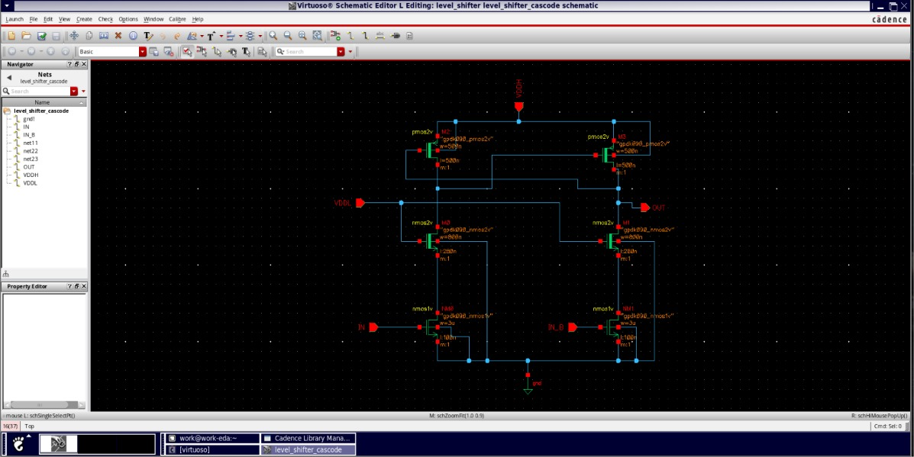
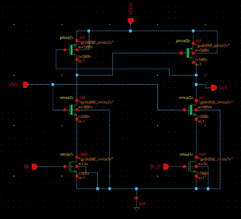
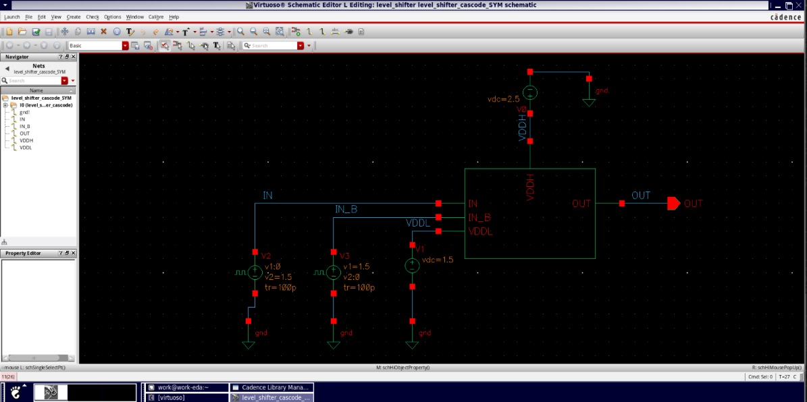
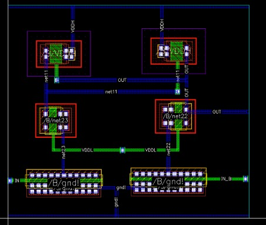

# Cascode Voltage Level Shifter Design using 90nm CMOS

## Overview

This project presents the design and simulation of a **Cascode Voltage Level Shifter** using 90nm CMOS technology in Cadence Virtuoso. The circuit translates digital signals from a low-voltage domain to a higher-voltage domain while protecting low-voltage transistors from excessive voltage stress.

The design converts a **1.5V input signal into a 2.5V output signal** using a cascode transistor structure and cross-coupled PMOS pull-up network. The circuit is evaluated through schematic design, layout implementation, and Spectre transient analysis.

## Objectives

* Design a cascode-based CMOS voltage level shifter.
* Enable reliable signal interfacing between different voltage domains.
* Reduce voltage stress on low-voltage input transistors.
* Verify the switching behavior through transient simulation.
* Examine the schematic and physical layout of the circuit.

## Design Specifications

| Parameter                     | Specification                 |
| ----------------------------- | ----------------------------- |
| Circuit                       | Cascode Voltage Level Shifter |
| Technology                    | 90nm CMOS                     |
| PDK                           | GPDK090                       |
| Low-voltage supply (VDDL)     | 1.5V                          |
| High-voltage supply (VDDH)    | 2.5V                          |
| Input voltage swing           | 0V–1.5V                       |
| Output voltage swing          | 0V–2.5V                       |
| Test frequency                | 50 MHz                        |
| Transient simulation duration | 100 ns                        |
| Design and simulation tools   | Cadence Virtuoso and Spectre  |

## Circuit Architecture

The voltage level shifter consists of the following functional blocks:

### 1. Low-Voltage Input Stage

The input NMOS transistors receive complementary input signals, IN and IN_B, operating in the 1.5V voltage domain.

### 2. Cascode NMOS Stage

The cascode transistors provide intermediate voltage shielding to help limit the voltage stress on the low-voltage input devices.

### 3. Cross-Coupled PMOS Network

The cross-coupled PMOS transistors form the pull-up network connected to the higher-voltage supply. Their switching action helps translate the input logic state into the 2.5V output domain.

### 4. Output Stage

The output stage produces a level-shifted digital signal with a target voltage swing from 0V to 2.5V.

## Repository Structure

```text
Level_Shifter/
├── Layout.jpeg
├── schematic.jpeg
├── schematic_zoomed.jpeg
├── Test_Schematic.jpeg
├── Transient Analysis.jpeg
├── input.scs
├── sch.oa
├── sch_main.oa
├── .gitattributes
├── .gitignore
├── LICENSE
└── README.md
```

## Schematic Design

The circuit schematic illustrates the transistor-level implementation of the cascode voltage level shifter.



### Detailed Schematic

The zoomed schematic provides a closer view of the transistor connections and sizing.



## Testbench Setup

The testbench applies a pulsed input signal in the 1.5V domain and uses a 2.5V supply for the high-voltage domain. The setup is used to evaluate the circuit's dynamic switching response.



## Physical Layout

The layout represents the physical implementation of the voltage level shifter in the selected CMOS process.



## Simulation Results

Spectre transient analysis is used to examine the input and output waveforms over a 100 ns simulation interval.

The expected behavior is:

* The input signal switches between 0V and 1.5V.
* The output signal transitions between 0V and 2.5V.
* The output follows the corresponding input logic state after the circuit's propagation delay.


## Tools and Technologies

* **Cadence Virtuoso** — Schematic capture and layout design.
* **Cadence Spectre** — Circuit-level transient simulation.
* **GPDK090** — 90nm CMOS process design kit.
* **CMOS circuit design** — Transistor-level voltage-domain interfacing.

## Applications

Voltage level shifters are commonly used in:

* Multi-voltage System-on-Chip (SoC) designs.
* Low-power digital integrated circuits.
* Interfacing between different CMOS logic voltage domains.
* Mixed-voltage digital systems.

## License

This project is distributed under the MIT License. Refer to the `LICENSE` file for details.

## Author

Developed as a CMOS VLSI circuit design and simulation project.
